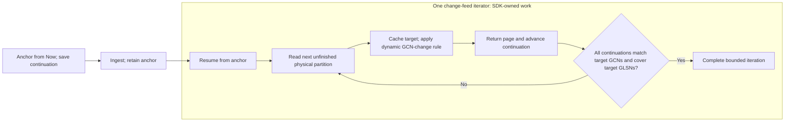

# Change Feed Read-Until Investigation

**Status:** Draft | **Date:** 2026-11-23 | **Author:** Not specified

## 1. Problem Statement

The change feed for a tenant's partial partition key must catch up after that tenant stops writing, even while other tenants continue to write.

The proposed mechanism must support **LatestVersion and AllVersionsAndDeletes (AVAD)**. When the SDK reports completion, it means that the data has been returned, not that the application has applied it.

Partition merges are out of scope.

## 2. SDK-Side Proposal

### Read Until a GLSN

**Current availability:** The .NET SDK does not currently offer this read-until-GLSN option. The behavior below is a proposed enhancement.

**The iterator resumes from the customer's anchor and caches target GLSNs for the physical partitions covered. It stops when continuation progress reaches or exceeds every cached target GLSN.**

In addition to selecting the container and feed mode, the customer supplies the existing anchor and requests bounded reading. The customer does not need to discover partitions, supply target GLSNs, or pass a second continuation.

`Now` is used only to establish the original anchor before ingestion. After ingestion, the iterator resumes that anchor and caches each covered physical partition's target GLSN from its first successful replay response's session token.

There are three distinct pieces of state:

| State | Where it comes from | Does it change during replay? |
|---|---|---|
| Anchor continuation | Saved after initial anchoring from Now | No; it defines where this workload begins |
| Target GLSNs for the physical partitions covered | GLSN components of their first replay response session tokens | Only the dynamic-target follow-up permits replacement. |
| Progress continuation | Returned after each replay page | Yes; it records how far the reader has advanced |

There is no single container-wide target GLSN. The SDK associates each covered physical partition's target GLSN with its tracked FeedRange and compares progress internally. Customers do not need to parse tokens. This follows Java's [first-response target selection](https://github.com/Azure/azure-sdk-for-java/blob/main/sdk/cosmos/azure-cosmos/src/main/java/com/azure/cosmos/implementation/feedranges/FeedRangeCompositeContinuationImpl.java#L270-L288).

The example below uses recorded AVAD values from SDK 3.64.0. It illustrates the rule and an observed premature stop, not a validated coverage guarantee. Both modes require validation.

#### 1) Anchor, ingest, and keep the original continuation

Before the ingestion being tracked begins, the customer starts tenant A's partial-partition-key feed from Now and reads to populate its continuation. The customer saves that continuation as the anchor and keeps it unchanged while ingestion proceeds. In the recording, the anchor was at position **90**.


```json
{
  "V": 2,
  "Rid": "S7slAIZYxyc=",
  "Continuation": [
    {
      "FeedRange": {
        "type": "Logical Partition Key",
        "value": "[\"A\"]"
      },
      "State": { "type": "continuation", "value": "\"90\"" }
    }
  ]
}
```

`V: 2` is the SDK continuation-format version, not the partition's vector-clock configuration version. The customer retains the opaque token. The decoded representation above is provided only to explain the example.


After anchoring, the container split from one to four physical partitions. Tenant A then overlapped physical partitions represented by partition-key ranges 3 and 4. The SDK tracks the corresponding tenant-scoped FeedRanges as R1 and R2. Resumption preserves position 90 and the tenant restriction while resolving these children.

#### 2) Resume the anchor and cache target GLSNs

After ingestion finishes, the customer creates the bounded reader from the saved anchor. The iterator then performs the following steps:

1. The iterator validates the anchor and resolves the physical partitions covered by its FeedRange scope.
2. The iterator reads changes from the anchor in the selected feed mode.
3. When the iterator receives a partition's first successful replay response, it reads the `x-ms-session-token` response header, extracts its GLSN component, and caches that value as the partition's target GLSN.
4. The iterator advances continuation progress after every response. The dynamic-target follow-up defines when it may replace the cached target.

##### How the iterator obtains a target GLSN

The target GLSN comes from the service's response session token, not the anchor or continuation.

For example, the first recorded replay request targeting partition-key range 3 returned these response headers:

```text
x-ms-session-token: 5:2#12784#2=4614
ETag: "412"
```

In this vector-session-token format, the number immediately after the first `#` is the GLSN. The value `5` is the response token's partition-key-range prefix, the following `2` is its configuration version, and `2=4614` is a regional progress component.

Under the proposed rule, the iterator extracts **12784** and caches it as the **target GLSN** for the tracked request scope. Separately, it updates continuation progress to **412** from the response ETag. Since 412 is less than 12784, the iterator continues reading that scope.

The iterator acquires target GLSNs while replaying changes, rather than in a separate preparatory pass. When the iterator resumes from a bounded continuation, it restores progress and cached targets. A partition without a target cannot be considered complete.

The recorded first replay responses supplied these target GLSNs.

| Requested partition-key range / tracked FeedRange | Original resume position | Response `x-ms-session-token` | Extracted target GLSN |
|---|---:|---|---:|
| 3 / R1 | 90 | `5:2#12784#2=4614` | 12784 |
| 4 / R2 | 90 | `5:2#12786#2=4614` | 12786 |

Both responses have token prefix `5`, although requests targeted ranges `3` and `4`. This unresolved partition-association discrepancy requires validation.

Ordinary writes do not move the targets forward. The GCN-change follow-up permits conditional replacement. Targets never replace starting continuations.

#### 3) Cycle through physical partitions and compare progress

The reader begins at **90**. Each returned page supplies an updated progress continuation for the tracked FeedRange on the physical partition just read.



The iterator cycles through the tracked FeedRanges on unfinished physical partitions in round-robin order and reads one backend page per turn. After each response, it updates progress only for the range it just read. An empty 200 response can advance that range's continuation even though it returns no tenant documents.

Once progress reaches or exceeds a partition's target GLSN with matching GCNs, the iterator stops polling its tracked range but retains its state. It continues reading the remaining partitions. The SDK matches continuation entries by FeedRange rather than by array index because queue rotation changes their order.

For the numeric positions in this recording, the proposed stopping condition is **R1 progress >= 12784 AND R2 progress >= 12786**.

The SDK compares the advancing continuation's LSN with the cached target GLSN. It does not compare the original anchor, whole session-token strings, timestamps, or item counts.

The following recorded pages show how this rule would evaluate the continuation positions.

| Recorded SDK page | R1 progress | R2 progress | Stop according to this rule? |
|---|---|---|---|
| 1 | 412 | 90 | No |
| 2 | 412 | 507 | No |
| 114 | 12957 | 13547 | Yes; both target GLSNs crossed |


#### 4) Complete this workload, not the change feed itself

The iterator returns the final page before completing bounded iteration. A returned continuation describes where future reading could resume; it does not indicate unfinished bounded work.

Completion does not require a 304 response, a null continuation, or a matching document at the exact target GLSN.

#### Exact request/response illustration

The protocol separates continuation progress from the response-session GLSN used as the target.


The routing values for R1 were recorded. The mode, paging, and conditional values were verified from SDK construction and probe configuration. A complete original request dump was not retained. The illustration shows only the feed-mode, routing, filtering, paging, and continuation headers. It omits authentication, consistency, API-version, date, and diagnostic headers.

```text
A-IM: Full-Fidelity Feed
x-ms-cosmos-changefeed-wire-format-version: 2021-09-15
x-ms-documentdb-partitionkeyrangeid: 3
x-ms-read-key-type: EffectivePartitionKeyRange
x-ms-start-epk: 14F53A0810CE6727EB1CD722D321216F
x-ms-end-epk: 14F53A0810CE6727EB1CD722D321216F20CBF0B6F2A51BE47D2B2BC922077DBB
If-None-Match: "90"
x-ms-max-item-count: 100
```

For R2, the routing header is `x-ms-documentdb-partitionkeyrangeid: 4`. Its scope matches the physical range, so this path does not add `x-ms-read-key-type`, `x-ms-start-epk`, or `x-ms-end-epk`. The other listed headers are unchanged.

The first replay responses advanced R1 to 412 and R2 to 507. **Session tokens are not passed as feed continuations.** A document's ETag is also not a feed continuation.

Initial anchoring uses `If-None-Match: *`. Replay instead sends `If-None-Match: "90"` and then each range's preceding response ETag. It never substitutes the target GLSN for that continuation.

The public .NET feed wrapper exposes the composite continuation, request charge, and activity ID, not these service session/ETag headers. Target GLSN caching and comparison belong inside the SDK.

LatestVersion's mode-setting code supplies `A-IM: Incremental Feed` without the AVAD wire-format header. Transport encoding may differ and does not define the bounded-read contract.


#### Assumptions and limitations

- Production use requires validating both response-session target selection and continuation comparability in both modes. Scalar comparison alone is insufficient.
- **False progress:** GLSN can move backward when a newer GCN (the session token's configuration version) is returned.
- **Partition merges are out of scope.**

#### Follow-up: Dynamic Targets After a GCN Change

The SDK would retain each partition's full anchoring and continuation-associated session tokens separately from its target GCN and GLSN. This remains a proposed follow-up.

On every successful change-feed response, the SDK would apply these rules in order:

1. If `responseGCN > cachedGCN`, the SDK would adopt the response's GCN and GLSN. Otherwise, it would retain the target, including for older-GCN responses.
2. The SDK would compare continuation progress against the target GLSN only when the continuation-associated session token's GCN equals the target GCN. Otherwise, it would continue draining without declaring completion.

##### Example 1: The target changes, and the continuation catches up

The partition anchors at GCN 1/continuation 90. The first replay response establishes target `(1,105)`. Response and target pairs below mean `(GCN, GLSN)`; continuation pairs mean `(associated GCN, LSN)`. These are hypothetical values, not wire-format tokens.

| Response | Target before | Target after | Continuation | Decision |
|---|---|---|---|---|
| `(1,110)` | `(1,105)` | `(1,105)` | `(1,100)` | The target stays, and reading continues. |
| `(2,100)` | `(1,105)` | `(2,100)` | `(1,108)` | The target changes, but the continuation GCN still differs. |
| `(2,110)` | `(2,100)` | `(2,100)` | `(2,99)` | GCNs match, but progress remains below 100. |
| `(2,115)` | `(2,100)` | `(2,100)` | `(2,103)` | This partition completes with over-reading. |

##### Example 2: A newer GCN takes precedence

Each independent case starts with target `(1,105)`.

| Response | Target after | Explanation |
|---|---|---|
| `(1,100)` | `(1,105)` | The GCN is unchanged. |
| `(1,110)` | `(1,105)` | Same-GCN writes cannot advance the target. |
| `(2,110)` | `(2,110)` | The newer GCN takes precedence despite the higher GLSN. |
| `(2,105)` | `(2,105)` | The newer GCN takes precedence despite the equal GLSN. |
| `(0,120)` | `(1,105)` | The response GCN is older. |

With false-progress merging enabled, [VectorSessionToken.Merge](../Microsoft.Azure.Cosmos/Direct/src/Session/VectorSessionToken.cs#L259) selects the newer GCN's GLSN. Normal same-GCN merging takes the maximum GLSN; the target policy deliberately does not, avoiding a moving target.

All partitions must complete, and resume must preserve target updates and continuation-associated tokens. The service must establish continuation GCN and coverage semantics; copying the latest response GCN onto an older continuation would bypass validation.

## 3. Why Event Timestamps and Customer Tokens Are Insufficient

### Why `_crts` does not prove completion

AVAD exposes the conflict-resolution timestamp as per-event `crts` metadata, not as a page-level scan watermark. An empty page has no event timestamp, and a tenant that has stopped writing may never produce an event beyond the cutoff. LatestVersion does not expose the same metadata, so this cannot provide mode-agnostic completion.

### Responsibilities for customer-supplied session tokens

The writers are responsible for preparing a compound session token across all writers for the tenant. The SDK must then merge its partition-specific segments. This adds partition-level reconciliation and physical partition lineage validation. This adds for extra logic on both the customer's writing app and within the SDK.
