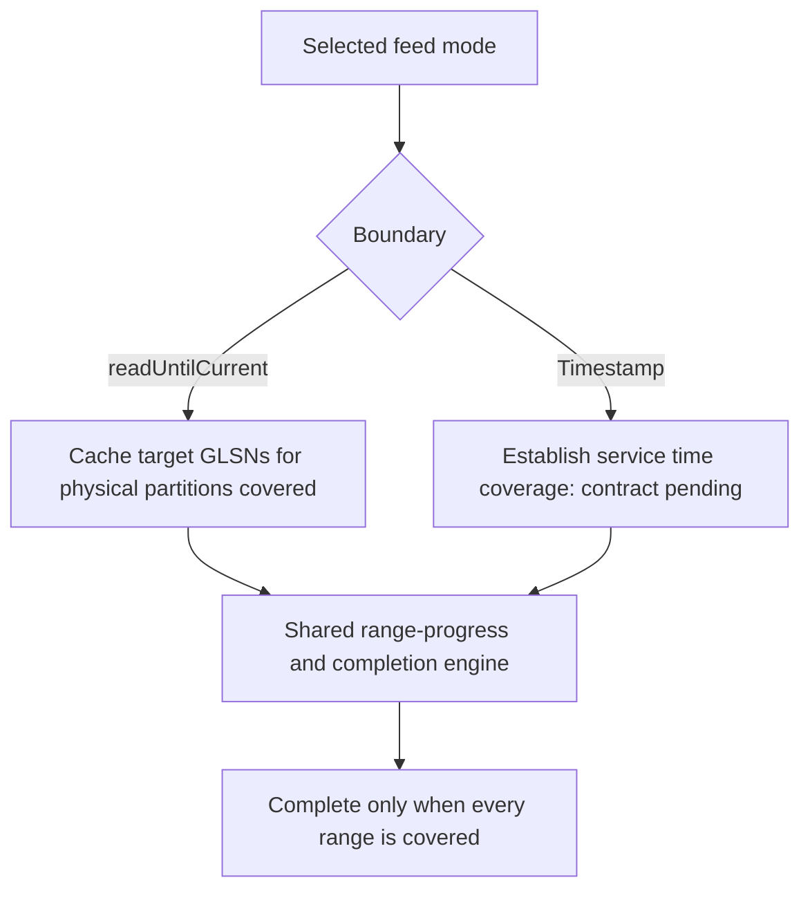

# Change Feed Read-Until Test Specification

**Status:** Draft | **Created:** 2026-11-22 | **Updated:** 2026-11-23 | **Author:** Not specified

## 1. Objective

Validate shared target selection, progress, completion, and resume for **LatestVersion and AllVersionsAndDeletes (AVAD)**. Preserve mode semantics; require SDK-managed partition resolution. Allow over-reading; exclude initial copy and historical snapshots.

Partition merges are out of scope.

## 2. Setup

- Create an isolated **6,000 RU/s manually provisioned** HPK container with `/TenantId`, `/UserId`. Enable AVAD and sufficient retention.
- Record multi-write regions, consistency, retention, and source-readiness assumptions.
- Ingest A and B concurrently across full partition keys: creates, repeated updates, and explicit deletes. Keep an external acknowledged-operation ledger.
- Record topology. Update the offer to 20,000 RU/s, then 40,000 if needed. Allow 30 minutes per split; verify completion and restore 6,000 RU/s.
- Require A across at least two child ranges and background writes sharing one. Add background tenants if needed. Otherwise report the scenario blocked. Delete only test-owned resources afterward.

## 3. Execution Matrix

Run both modes through typed/stream APIs for single-/multi-range prefixes. Mode is independent of boundary selection.

1. Before verification ingestion, anchor each mode from **Now** and save continuations; never reuse across modes.
2. Begin uniquely identified verification operations after both anchors, avoiding initial-seek races.
3. Split while writers continue. Verify parent/child topology; retain pre-split anchors.
4. Fence A, await in-flight writes, and leave background writers active. Record cutoff time and maximum acknowledged document `_ts`; track deletes separately.
5. Replay independently from each mode's anchor with the selected boundary. Cover immediate/delayed starts within retention and restart from a bounded continuation.
6. Process pages, assert mode-specific coverage, and finish while background writers remain active. Deadlines fail explicitly.

## 4. Proposed Boundary Contracts

Names denote proposed APIs:

**Current:** Resume the anchor and cache each partition's first successful replay response session target. Ordinary writes must not move targets; the dynamic-target test covers the exception. Missing targets prevent completion. No second Now probe is allowed.

**Timestamp:** Customer supplies Unix `t0` and nonnegative `delta`. Proposed target is service-confirmed time `t0 + delta`, not a per-document predicate. Require the same defined time-coverage contract for both modes, including empty responses. Until available, require explicit unsupported behavior; do not substitute LatestVersion `_ts` or Now.

Buffer is an operational allowance, not a replication guarantee. Test `t0 = maxWriteTs` and independent cutoffs. Persist scope, mode, target GCNs/GLSNs, and continuation-associated tokens; reject conflicts, malformed tokens, mode changes, and negative buffers. Unbounded defaults remain unchanged.

## 5. Acceptance and Oracles

| Feed mode | Current-boundary data coverage |
|---|---|
| AVAD | All expected post-anchor events, including intermediary versions and deletes. Correlate ledger identities with an independent AVAD reference consumer. |
| LatestVersion | Latest surviving versions for the verification IDs at the stable cutoff; compare with the final-state ledger/query. Do not require intermediate versions or delete notifications. |

- No background-tenant data leaks after splits or restart.
- Use models omitting system timestamps to prove shared completion does not inspect payload fields.
- Empty 200s and 304s cannot independently signal completion. Verify all-partition progress, timestamp ties, lagging partitions, and fixed target GLSNs despite continued writes.
- Cover splits before and after caching target GLSNs. Unsupported remapping must fail explicitly, never drop an uncovered child.
- Inject target GCN 1/GLSN 105 followed by response GCN 2/GLSN 100; require target replacement. With continuation GCN 1/LSN 108, drain without comparison; with GCN 2, stop only at LSN >= 100. Either update condition alone must not replace the target.
- Inject errors, cancellation, and timeouts; none may report `TargetReached`.
- Record target GLSNs, progress, statuses, counts, RU charges, and elapsed time without credentials or document bodies.

## 6. Evidence and Release Gates

Existing evidence is AVAD-only; LatestVersion validation is required. Reproduce the first-response rule's 595-event shortfall. Event-only cutoff tracking stalled on empty 200s; AVAD time seeks returned 400.

Verify target selection, cursor comparability, split remapping, and service time coverage. Reference: [Java bounded catch-up](https://github.com/Azure/azure-sdk-for-java/pull/42160). Full acceptance testing remains pending.
